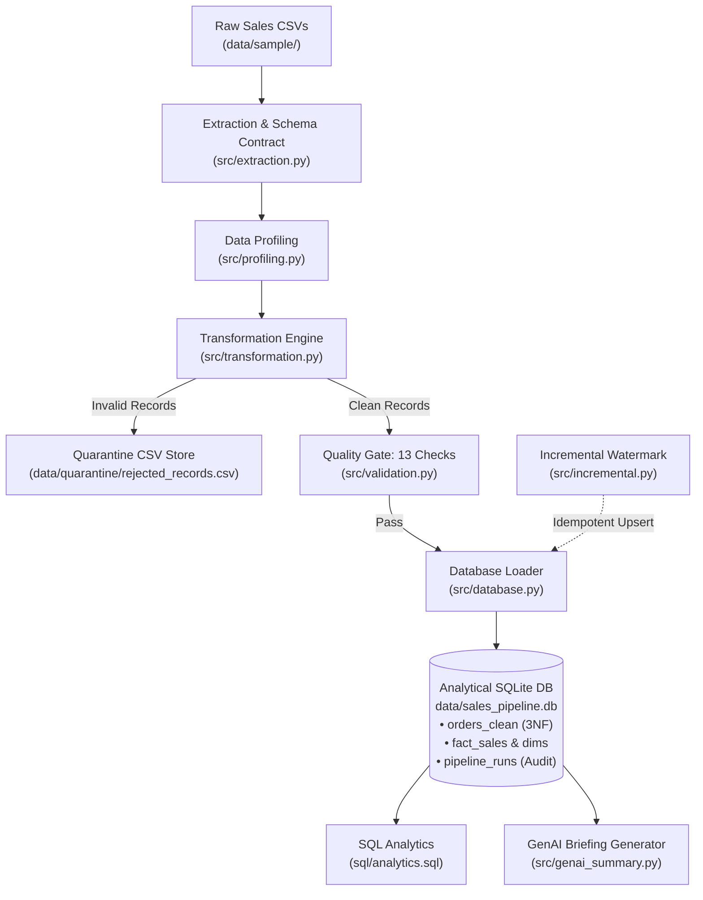

# Sales Data Engineering Pipeline

A modular Python-based ETL pipeline designed to extract, profile, clean, validate, and load transactional sales data into an analytical SQLite database with automated data quality gating, Kimball star schema modeling, and SQL analytics.

---

## Overview

In production data environments, raw sales feeds from ERP systems and e-commerce platforms often arrive with data quality defects: missing primary keys, corrupt dates, duplicate transaction IDs, negative prices or quantities, and invalid categorical entries. 

This project implements an end-to-end, resilient batch ETL pipeline that:
1. Ingests raw CSV records while enforcing strict schema contracts.
2. Profiles data completeness and statistical distributions before processing.
3. Cleans and normalizes records through an 8-phase transformation engine.
4. Segregates defective rows into an auditable quarantine store with diagnostic error annotations.
5. Verifies 13 automated pre-load data quality checks before committing records to storage.
6. Loads clean data into both an operational 3NF table and an analytical Kimball Star Schema.
7. Supports idempotent incremental loads, ensuring repeated batch runs never insert duplicates.
8. Provides 12 business intelligence SQL queries and a GenAI prompt synthesizer.

---

## Key Features

- **Schema-Enforced Extraction:** Validates required column presence (`REQUIRED_COLUMNS`) on ingestion and raises clear exceptions on schema drift.
- **Automated Data Profiling:** Generates structured JSON reports detailing null counts, uniqueness, and numerical metrics (min, max, mean, std).
- **Defensive Cleaning & Normalization:** Resolves mixed date formats (`YYYY-MM-DD` and `DD/MM/YYYY`), standardizes status and geographic regions, and deduplicates business keys on `order_id`.
- **Rejection Quarantine Layer:** Rather than silently discarding invalid rows, rejected transactions are preserved in `data/quarantine/rejected_records.csv` with a documented `rejection_reason`.
- **Pre-Load Data Quality Gate:** Programmatic verification of 13 data quality rules (uniqueness, referential bounds, non-negative values) producing a JSON scorecard.
- **Kimball Star Schema:** Automatically populates `fact_sales` and conformed dimensions (`dim_product`, `dim_date`, `dim_region`) for optimized OLAP reporting.
- **Idempotent Incremental Ingestion:** Tracks loaded transaction keys in `loaded_order_ids`, ensuring that re-running identical batches inserts 0 duplicate rows ($f(f(x)) = f(x)$).
- **SQL Analytics Engine:** 12 analytical queries demonstrating aggregations, window functions (`ROW_NUMBER`, `DENSE_RANK`, `LAG`), CTEs, and star schema joins.
- **GenAI-Ready Prompt Generator:** Aggregates verified database KPIs into structured LLM prompt templates and deterministic briefings without external API dependencies.
- **Automated Testing & CI:** 42 unit, regression, and integration tests running under pytest with GitHub Actions CI across Python 3.10, 3.11, and 3.12.
- **Interactive CLI:** Menu-driven terminal interface with 7 operational commands.

---

## Architecture



---

## Tech Stack

| Technology | Role & Purpose |
|---|---|
| **Python 3.10+** | Core pipeline orchestration, data processing, and CLI |
| **Pandas & NumPy** | Ingestion, data cleaning, type coercion, and feature engineering |
| **SQLite** | Local relational data warehouse and operational store |
| **SQLAlchemy** | Database connection management and SQL execution abstraction |
| **SQL** | Analytical queries (window functions, CTEs, star schema joins) |
| **pytest** | Automated test suite (42 tests covering unit, regression, and integration) |
| **GitHub Actions** | Automated CI pipeline testing across Python 3.10, 3.11, and 3.12 |

---

## Project Structure

```text
sales-data-engineering-pipeline/
├── .github/
│   └── workflows/
│       └── tests.yml           # Multi-version CI matrix (Python 3.10, 3.11, 3.12)
├── data/
│   └── sample/
│       ├── generate_sample_data.py # Reproducible synthetic sales data generator
│       ├── batch_001.csv       # Primary sample batch (100 rows)
│       └── batch_002.csv       # Incremental sample batch with overlaps (70 rows)
├── docs/
│   └── README.md               # Documentation and schema reference index
├── sql/
│   ├── schema.sql              # DDL for operational, star schema, and metadata tables
│   ├── analytics.sql           # 12 business intelligence queries
│   └── data_quality.sql        # Supplementary SQL data quality audit queries
├── src/
│   ├── extraction.py           # Ingestion and schema contract validation
│   ├── profiling.py            # Statistical data profiling and JSON export
│   ├── transformation.py       # 8-phase transformation and quarantine routing
│   ├── validation.py           # 13 pre-load automated data quality checks
│   ├── database.py             # SQLite persistence and star schema population
│   ├── incremental.py          # Idempotent incremental loading engine
│   ├── analytics.py            # Programmatic runner for SQL analytics
│   ├── genai_summary.py        # LLM prompt synthesizer and briefing generator
│   ├── pipeline.py             # Master ETL orchestrator
│   └── cli.py                  # Interactive CLI interface
├── tests/
│   ├── conftest.py             # Test path configuration
│   └── test_pipeline.py        # 42 pytest automated tests across 8 classes
├── .gitignore                  # Git exclusions for databases, cache, and reports
├── LICENSE                     # MIT License
├── README.md                   # Repository home documentation
├── requirements.txt            # Production dependencies
└── run_tests.py                # Standalone test runner script
```

---

## Quick Start

### 1. Clone the Repository
```powershell
git clone https://github.com/BALANJANEYULU-799/sales-data-engineering-pipeline.git
cd sales-data-engineering-pipeline
```

### 2. Set Up Virtual Environment
```powershell
python -m venv venv
.\venv\Scripts\Activate.ps1
```

### 3. Install Dependencies
```powershell
python -m pip install --upgrade pip
pip install -r requirements.txt
```

### 4. Generate Sample Data
```powershell
python data/sample/generate_sample_data.py
```
*Creates `data/raw/sales_raw.csv` (210 rows) containing intentional data quality edge cases.*

### 5. Run the Full ETL Pipeline
```powershell
# Full refresh mode (recreates tables)
python src/pipeline.py --mode replace

# Incremental mode (idempotent delta load)
python src/pipeline.py --mode upsert
```

### 6. Run the Interactive CLI
```powershell
python src/cli.py
```
*Provides interactive subcommands: `run`, `profile`, `validate`, `analytics`, `summary`, `genai`, and `demo-incr`.*

### 7. Run the Test Suite
```powershell
python run_tests.py
# Or directly via pytest:
pytest tests/ -v
```

---

## Sample Execution Output

Executing `python src/pipeline.py --mode replace` on the standard 210-record raw dataset produces the following reconciled execution log:

```text
=================================================================
  SALES DATA ENGINEERING PIPELINE
  Mode: REPLACE   Batch: full_load
=================================================================

[1/6] EXTRACT
      ✓ Read 210 rows from data/raw/sales_raw.csv
[2/6] PROFILE
      ✓ Profile saved → reports/data_profile.json
        Rows: 210 | Duplicates: 10 | Total nulls: 67
[3/6] TRANSFORM
      ✓ Clean records retained: 190
      ✓ Quarantined records  : 20
[4/6] VALIDATE
      ✓ Pre-load checks: 13/13 passed [PASS]
      ✓ DQ report saved → reports/data_quality_report.json
[5/6] LOAD
      ✓ Full replace: 190 rows loaded into orders_clean
      ✓ Star schema populated: fact_sales (190 rows), dim_product (12), dim_region (6), dim_date (151)
[6/6] PIPELINE COMPLETE
      Rows extracted : 210
      Rows clean     : 190
      Rows rejected  : 20
      Total revenue  : $204,491.38
      Elapsed time   : 0.59s
=================================================================
```

### Incremental Loading Reconciliation Math

When processing multi-batch sales data in incremental mode (`--mode upsert`):
- **Batch 1 (`batch_001.csv`):** 100 raw records → 91 clean, 9 quarantined → **91 rows loaded**.
- **Batch 2 (`batch_002.csv`):** 70 raw records → 1 quarantined (`order_id=10142` has negative quantity `-5`) → **69 clean rows**.
  - **20 rows** share `order_id`s already loaded in Batch 1 → **skipped (idempotent deduplication)**.
  - **49 rows** represent brand-new orders → **inserted into `fact_sales` and `orders_clean`**.
- **Exact Equation:**
  $$\text{Raw Input (70)} = \text{Clean (69)} + \text{Quarantined (1)}$$
  $$\text{Clean (69)} = \text{New Inserts (49)} + \text{Skipped Duplicates (20)}$$
  $$\text{Total Cumulative Unique Orders in Database} = 91 + 49 = 140\ \text{orders}$$

---

## Data Quality Rules & Quarantine

The pipeline enforces a two-tier data hygiene architecture:

| Rule | Condition | Action Taken |
|---|---|---|
| **Mandatory Primary Fields** | Missing `order_id`, `product`, `unit_price`, or `order_date` | **Quarantined** with reason string |
| **Quantity Domain Bounds** | `quantity <= 0` | **Quarantined** with reason string |
| **Price Domain Bounds** | `unit_price <= 0` | **Quarantined** with reason string |
| **Business Key Uniqueness** | Duplicate `order_id` within batch | **Quarantined** older record; retained latest occurrence |
| **Promotional Discount Range**| `discount < 0` or `discount > 1` | **Clamped** to range `[0.0, 1.0]` (soft correction) |
| **Order Status Validity** | Status not in `{Completed, Pending, Cancelled, Refunded}` | Set to `NaN` → defaulted to `'Pending'` |
| **Geographic Region** | Region not in canonical zones or `'N/A'` | Set to `NaN` → defaulted to `'Unknown'` |
| **Email Syntax** | Fails RFC regex validation | Set to `NaN` (non-blocking) |
| **Mixed Date Formats** | Contains ISO (`YYYY-MM-DD`) or European (`DD/MM/YYYY`) | Standardized to unified datetime representation |

Quarantined records are exported to `data/quarantine/rejected_records.csv` alongside a descriptive `rejection_reason` column, enabling data teams to triage and remediate source upstream issues without polluting analytics tables.

---

## Database Architecture & Analytics

### 1. Operational Table (`orders_clean`)
Indexed 3NF table used for operational record lookups, with composite indexes on `status`, `category`, `region`, `order_date`, and `(order_year, order_month)`.

### 2. Kimball Star Schema (Analytical Warehouse)
- **`fact_sales`**: Granular fact table storing transactional numeric measures (`quantity`, `unit_price`, `gross_amount`, `discount_amount`, `net_amount`) joined to dimensions via foreign keys.
- **`dim_product`**: Product dimension table (`product_id`, `product_name`, `category`).
- **`dim_date`**: Calendar dimension table (`date_key`, `full_date`, `year`, `month`, `month_name`, `quarter`, `day_of_week`).
- **`dim_region`**: Geographic territory dimension (`region_id`, `region_name`).

### 3. Business Intelligence Queries (`sql/analytics.sql`)
The repository includes 12 commented SQL queries answering core business questions:
1. High-value completed orders filter (`SELECT ... WHERE ... ORDER BY`).
2. Overall business KPIs (revenue, average order value, discount impact).
3. Product category performance with volume filters (`GROUP BY ... HAVING`).
4. Monthly revenue trends and seasonality.
5. Category revenue share percentage using `SUM() OVER ()`.
6. Top-performing products within each category using `DENSE_RANK() OVER (PARTITION BY ...)`.
7. Month-over-month revenue growth calculation using `LAG()`.
8. Customer segmentation into High, Medium, and Low-value tiers using Common Table Expressions (CTEs).
9. Order size distribution using `CASE WHEN`.
10. Regional revenue breakdown via star schema `fact_sales` ↔ `dim_region` join.
11. Quarterly revenue aggregation via `fact_sales` ↔ `dim_date` join.
12. Data quality audit query identifying discrepancies between gross and net totals.

---

## Automated Testing & CI

The repository maintains an automated test suite implemented in `pytest`:

```text
tests/test_pipeline.py
├── TestExtractor          (7 tests)  - Ingestion, schema contracts, profiling stats
├── TestTransformer        (13 tests) - Parsing, bounds checking, deduplication, derived columns
├── TestQuarantine         (3 tests)  - Rejection capture and audit reason strings
├── TestValidator          (5 tests)  - Automated pre-load quality assertions
├── TestDatabaseLoader     (4 tests)  - Table replace, upsert, and schema verification
├── TestIncrementalLoader  (5 tests)  - Watermark tracking and idempotency guarantees
├── TestIntegration        (2 tests)  - End-to-end execution on synthetic datasets
└── TestGenAISummary       (1 test)   - KPI extraction and prompt generation
Total: 42 passed in ~3.9 seconds (0 failures, 0 warnings)
```

**Continuous Integration:**  
The workflow defined in `.github/workflows/tests.yml` automatically executes the entire test suite on every `push` and `pull_request` targeting `main` across a test matrix of Python **3.10**, **3.11**, and **3.12**.

---

## Limitations & Future Roadmap

- **Storage Engine:** Currently utilizes SQLite for zero-friction local execution. In an enterprise cloud deployment, the SQLAlchemy connection can be updated to target Amazon Redshift, Snowflake, or Google BigQuery.
- **Workflow Orchestration:** Currently executed via Python scripts and CLI. A natural extension is wrapping the tasks into an Apache Airflow DAG or Prefect workflow for scheduled cron execution.
- **Distributed Computing:** Built with Pandas for datasets up to several gigabytes. For multi-terabyte datasets, the transformation phase can be migrated to PySpark or AWS Glue.
- **Streaming Ingestion:** Operates as a batch pipeline. Streaming architectures would integrate Apache Kafka or AWS Kinesis for real-time event ingestion.

---

## License

This project is licensed under the **MIT License** — see the [LICENSE](LICENSE) file for details.

```text
Copyright (c) 2026 Balanjaneyulu
```

---

## Author

**Balanjaneyulu**  
B.Tech Computer Science (CGPA: 9.42, Class of 2027)  
GitHub: [@BALANJANEYULU-799](https://github.com/BALANJANEYULU-799)  
Project Repository: [sales-data-engineering-pipeline](https://github.com/BALANJANEYULU-799/sales-data-engineering-pipeline)
