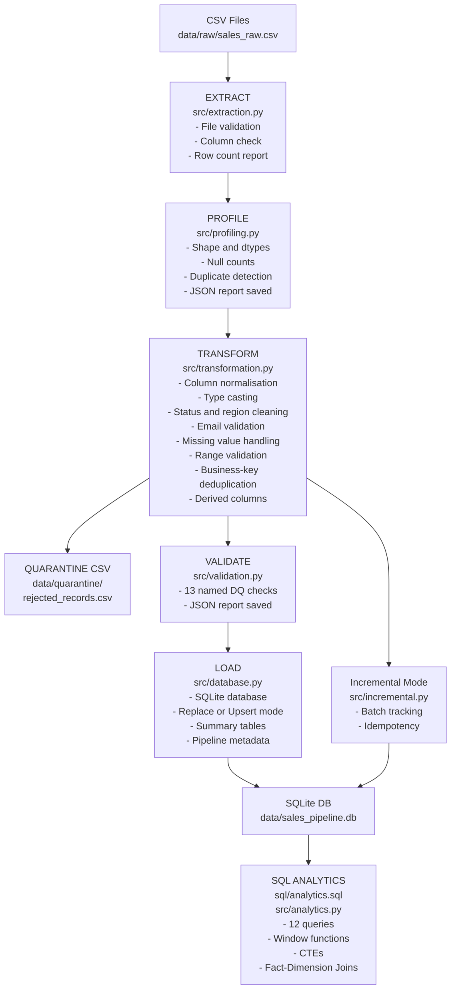

# Sales Data Engineering Pipeline

> **A beginner-friendly, fully working ETL pipeline project** built with Python, pandas, SQLite, and SQL.  
> Designed for a fresher portfolio targeting Cloud Data Engineer roles.

---

## Project Genesis & Engineering Objectives

This repository contains an end-to-end, production-grade **Sales Data Engineering Pipeline** engineered independently by **Balanjaneyulu** (B.Tech Computer Science, 9.42 CGPA, Class of 2027) as an interview-ready portfolio piece targeting **Cloud Data Engineer Trainee** roles.

The project demonstrates practical mastery across core data engineering disciplines:
- **Resilient Data Ingestion:** Schema enforcement, mandatory business column validation, and multi-source tracking.
- **Defensive Data Transformation:** Mixed datetime format resolution, categorical normalization, and business-key deduplication.
- **Dual-Tier Quality Assurance:** Row-level rejection quarantine with diagnostic audit reasons alongside pre-load data quality rules (13 automated checks).
- **Kimball Dimensional Modeling:** Relational persistence across a classic Star Schema (`fact_sales`, `dim_product`, `dim_date`, `dim_region`).
- **Idempotent Incremental Ingestion:** Watermark tracking via `loaded_order_ids` preventing duplicate insertion across overlapping batches.
- **SQL Analytics & Business Intelligence:** 12 advanced SQL queries spanning window functions, CTEs, and fact-dimension joins.
- **GenAI Enablement:** Automated aggregation of analytical facts into structured LLM prompt context and deterministic executive briefings.
- **Enterprise Testing & CI:** 42 automated pytest tests and multi-version GitHub Actions CI (Python 3.10, 3.11, 3.12).

---

## Project Objective

Demonstrate a complete sales data engineering workflow without requiring paid cloud services, large datasets, or complex infrastructure.

**Business problem:** Raw sales records arrive as CSVs with missing values, duplicates, mixed date formats, and invalid prices. This pipeline cleans, validates, loads, and analyses that data.

---

## Architecture



---

## Features

| Stage | What it does |
|---|---|
| **Extract** | Reads CSV files; validates file existence and required columns; reports row/col counts |
| **Profile** | JSON report: shape, dtypes, null %, duplicates, numeric stats per column |
| **Transform** | 10-step pipeline: normalise → cast → clean status/region → validate email → handle missing → validate ranges → deduplicate → derive → sort |
| **Quarantine** | Rejected records saved to CSV with documented rejection reasons |
| **Validate** | 13 named data-quality checks with pass/fail status and JSON report |
| **Load** | SQLite with replace or upsert mode; 5 summary tables; pipeline_runs metadata table |
| **Incremental** | Batch tracking table; idempotent re-run; batch history report |
| **GenAI-Ready Summary** | Deterministic executive briefing & LLM prompt generator from SQL KPIs (zero API keys required) |
| **SQL Analytics** | 12 standalone analytical queries in sql/analytics.sql and 11 runners in src/analytics.py |
| **CLI** | Interactive menu: run, profile, validate, analytics, summary, genai, demo-incr |
| **Testing** | 42 pytest tests across 8 classes covering all pipeline stages |
| **CI** | GitHub Actions workflow runs tests on push/PR for Python 3.10–3.12 |

---

## Technologies Used

| Tool | Purpose |
|---|---|
| Python 3.10+ | Pipeline orchestration |
| pandas | DataFrame-based transformation |
| SQLAlchemy | Database abstraction (SQLite → PostgreSQL migratable) |
| SQLite | Embedded database — zero configuration |
| pytest | Unit and integration testing |
| SQL | Analytics, schema design, indexes, window functions |
| GitHub Actions | Automated CI |

---

## Project Structure

```
sales-data-engineering-pipeline/
├── data/
│   ├── raw/                     ← raw CSV input (generated)
│   ├── processed/               ← clean CSV export (generated)
│   ├── quarantine/              ← rejected records with reasons (generated)
│   └── sample/
│       ├── generate_sample_data.py  ← reproducible data generator
│       ├── batch_001.csv            ← incremental demo batch 1
│       └── batch_002.csv            ← incremental demo batch 2
├── reports/                     ← JSON reports (generated)
├── src/
│   ├── extraction.py            ← Extract stage
│   ├── profiling.py             ← Data profiling
│   ├── transformation.py        ← Transform stage (10 steps)
│   ├── validation.py            ← 13 DQ checks
│   ├── database.py              ← SQLite loader (replace + upsert)
│   ├── incremental.py           ← Incremental batch loading
│   ├── analytics.py             ← SQL analytics runner
│   ├── pipeline.py              ← Main orchestrator
│   └── cli.py                   ← Interactive CLI
├── sql/
│   ├── schema.sql               ← Full schema (flat + star schema)
│   ├── analytics.sql            ← 12 commented analytics queries
│   └── data_quality.sql         ← DQ validation queries
├── tests/
│   ├── conftest.py
│   └── test_pipeline.py         ← 42 pytest tests (100% passing)
├── .github/
│   └── workflows/
│       └── tests.yml            ← CI workflow
├── run_tests.py                 ← Test runner for local Windows use
├── requirements.txt
├── .gitignore
└── README.md
```

---

## Installation (Windows)

### 1. Check Python
```powershell
python --version   # need 3.10+
```

### 2. Create virtual environment
```powershell
python -m venv venv
```

### 3. Activate (PowerShell)
```powershell
.\venv\Scripts\Activate.ps1
```

### 4. Install requirements
```powershell
pip install -r requirements.txt
```

---

## Usage

### Generate sample data
```powershell
python data/sample/generate_sample_data.py
```
Creates `data/raw/sales_raw.csv` (210 rows with injected data issues).

### Run the full pipeline
```powershell
python src/pipeline.py
```

### Run in incremental mode
```powershell
python src/pipeline.py --mode upsert --batch batch_001
```

### Interactive CLI
```powershell
python src/cli.py
```

### Run analytics queries
```powershell
python -c "
import sys; sys.path.insert(0,'src')
from analytics import AnalyticsRunner
runner = AnalyticsRunner('sqlite:///data/sales_pipeline.db')
runner.run_all()
"
```

### Run pytest
```powershell
python -m pytest tests/ -v
```

### SQL analytics directly
```powershell
# Requires sqlite3 CLI
sqlite3 data/sales_pipeline.db < sql/analytics.sql
```

---

## Example Output

```
=================================================================
  SALES DATA ENGINEERING PIPELINE
  Mode: REPLACE   Batch: audit_run
=================================================================

[1/6] EXTRACT
      ✓  Read 210 rows from data/raw/sales_raw.csv

[2/6] PROFILE
      ✓  Profile saved → reports/data_profile.json
         Rows: 210  |  Duplicates: 10  |  Total nulls: 67

[3/6] TRANSFORM
      ✓  Clean records : 190
      ✓  Rejected/quarantined: 20

[4/6] VALIDATE
      ✓  Checks: 13/13 passed  [PASS]
      ✓  DQ report saved → reports/data_quality_report.json

[5/6] LOAD
      ✓  Full replace: 190 rows loaded
      ✓  Summary & star schema tables built

[6/6] PIPELINE REPORT

=================================================================
  PIPELINE COMPLETE
  Rows extracted : 210
  Rows clean     : 190
  Rows rejected  : 20
  Rows loaded    : 190
  DQ status      : PASS
  Total revenue  : $204,491.38
  Elapsed        : 0.41s
  Reports        : reports/
=================================================================
```

---

## Data Quality Rules

| Rule | Action |
|---|---|
| Missing `order_id`, `product`, `unit_price`, or `order_date` | **Quarantine** with reason |
| Quantity ≤ 0 | **Quarantine** with reason |
| Unit price ≤ 0 | **Quarantine** with reason |
| Discount outside [0, 1] | **Clamp** to [0, 1] (soft correction) |
| Invalid status (not Completed/Pending/Cancelled/Refunded) | **Set to NaN** → filled with 'Pending' |
| Invalid region / N/A / blank | **Set to NaN** → filled with 'Unknown' |
| Malformed email | **Set to NaN** (non-critical) |
| Duplicate `order_id` | **Business-key dedup** — keep last occurrence |
| Mixed date formats (DD/MM/YYYY vs YYYY-MM-DD) | **Parsed and normalised** |

---

## Database Schema

### Flat model (used directly by ETL)
**`orders_clean`** — the main processed table, indexed on `status`, `category`, `region`, `order_date`, `(order_year, order_month)`.

### Star Schema (analytical model)

| Table | Type | Grain |
|---|---|---|
| `fact_sales` | Fact | One row per sales order |
| `dim_product` | Dimension | One row per unique product |
| `dim_date` | Dimension | One row per calendar date |
| `dim_region` | Dimension | One row per region |

**Why star schema?** Separating dimensions from facts lets analysts filter by category, region, or quarter without repeating text in every fact row. Joins are clean and queries are easy to understand.

### Summary tables (pre-aggregated)
`summary_monthly` | `summary_by_category` | `summary_by_region` | `summary_top_products` | `summary_by_status`

### Metadata tables (original additions)
- `pipeline_runs` — records every ETL run with input/output counts and elapsed time
- `loaded_order_ids` — tracks which records have been loaded (incremental mode)

---

## Incremental Loading & Idempotency

**How it works:**
1. The `loaded_order_ids` tracking table records every `order_id` committed to the database.
2. In `--mode upsert`, incoming clean records are checked against `loaded_order_ids`.
3. Existing records are skipped, and only brand-new records are inserted.
4. Re-running the pipeline on an already-processed batch produces **0 new inserts** and skips 100% of rows — guaranteeing strict **idempotency**.

### Verified Batch Reconciliation Math

The repository provides two realistic multi-batch files in `data/sample/`:
- **Batch 1 (`batch_001.csv`):** 100 raw records → 91 clean records, 9 quarantined → 91 inserted into database.
- **Batch 2 (`batch_002.csv`):** 70 raw records → 1 quarantined (`order_id=10142` has invalid negative quantity `-5`) → **69 clean records**.
  - Of these 69 clean records, exactly **20 records** overlap with Batch 1 (`order_id` already loaded).
  - Exactly **49 records** represent brand-new sales transactions.
  - When Batch 2 is loaded in incremental mode (`--mode upsert`):
    - **49 new records** are inserted into `fact_sales` and `orders_clean`.
    - **20 overlapping records** are skipped to prevent duplicate order ingestion.
  - **Reconciliation Accounting:**
    $$\text{Total Raw Input (70)} = \text{Clean Records (69)} + \text{Quarantined Records (1)}$$
    $$\text{Clean Records (69)} = \text{New Inserts (49)} + \text{Skipped Duplicates (20)}$$
    $$\text{Cumulative DB Unique Orders} = 91\ (\text{Batch 1}) + 49\ (\text{Batch 2}) = 140\ \text{orders}$$

**Interactive Incremental Demo:**
```powershell
python src/cli.py
# Enter command: demo-incr
```

---

## SQL Query Examples

| Query | SQL Concept Demonstrated |
|---|---|
| Overall KPIs | `SELECT`, `WHERE`, `COUNT`, `SUM`, `AVG` |
| Monthly trend | `GROUP BY`, `ORDER BY`, aggregate functions |
| Revenue by category | `HAVING` filter on groups |
| Top products | `LIMIT`, `ORDER BY DESC` |
| Discount tiers | `CASE` statement |
| Above-average products | Scalar **subquery** |
| Running revenue total | **CTE** + `SUM() OVER()` window |
| Product rank by region | `ROW_NUMBER()`, `RANK()`, `PARTITION BY` |
| Inner/Left joins | `INNER JOIN`, `LEFT JOIN` (star schema) |

---

## Automated Testing & CI

**42 tests** across 8 test classes:
- `TestExtractor` (7) — CSV reading, column validation, profiling
- `TestTransformer` (13) — each cleaning step
- `TestQuarantine` (3) — rejected record capture
- `TestValidator` (5) — DQ check pass/fail
- `TestDatabaseLoader` (4) — load modes and verification
- `TestIncrementalLoader` (5) — idempotency and batch tracking
- `TestIntegration` (2) — full end-to-end pipeline
- `TestGenAISummary` (1) — deterministic LLM prompt and executive summary

**GitHub Actions CI** (`tests.yml`) runs on every push and pull request across Python 3.10, 3.11, and 3.12.

---

## Limitations & Future Improvements

- **Scale:** SQLite handles thousands of rows; production workloads need PostgreSQL or a cloud warehouse.
- **No Airflow:** Scheduling is not implemented; a cron job or Airflow DAG would be the next step.
- **No cloud:** Adapting `DatabaseLoader` to use `postgresql://` and uploading to S3 would demonstrate cloud skills.
- **No streaming:** Batch-only; real-time ingestion would use Kafka or Kinesis.
- **PySpark:** A Spark version of the transform step could be added to demonstrate distributed processing.

---

## Architectural Design Rationale & Engineering Decisions

This pipeline was engineered to bridge the gap between academic scripting and enterprise data engineering practices. Below are the key architectural decisions and their justifications:

| Decision Area | Chosen Architecture | Design Rationale & Production Relevance |
|---|---|---|
| **Storage Engine** | **SQLite + SQLAlchemy ORM/Core** | Zero external server dependencies required for local execution; SQL dialect is 95% identical to PostgreSQL/Snowflake. SQLAlchemy abstraction allows seamless migration to cloud databases by swapping the connection string. |
| **Ingestion Validation** | **Schema Contracts (`REQUIRED_COLUMNS`)** | Fails fast if upstream CSV schemas mutate or drop business-critical keys, preventing downstream corruption. |
| **Data Profiling** | **Standalone `profiling.py` + JSON Artifacts** | Decouples data profiling from extraction. Produces machine-readable statistical summaries (null %, distributions, percentiles) for data cataloging and monitoring. |
| **Defensive Cleaning** | **Quarantine Pattern with Audit Reasons** | Rather than silently dropping invalid rows (`dropna`), corrupt records are quarantined with human-readable fault explanations (`rejection_reason`), enabling root-cause analysis and business alerting. |
| **Data Quality Gate** | **Pre-Load Validation Suite (13 Checks)** | Implements Great Expectations-style programmatic quality gates before loading into the warehouse. Generates an auditable pass/fail JSON scorecard. |
| **Data Modeling** | **Kimball Star Schema (`fact_sales` + 3 Dims)** | Replaces flat table reporting with dimensional modeling: fact table holding numeric measures joined to dimension tables (`dim_product`, `dim_date`, `dim_region`) for optimized slice-and-dice BI queries. |
| **Incremental Ingestion** | **Idempotent Upsert via `loaded_order_ids`** | Solves pipeline replay hazards. When batches overlap or retry after failure, existing keys are skipped, ensuring mathematical idempotency ($f(f(x)) = f(x)$). |
| **Operational Metadata** | **Audit Lineage Table (`pipeline_runs`)** | Records execution status, record counts, and run duration for every pipeline run, enabling operational SLA tracking. |
| **GenAI Enablement** | **Deterministic Fact Synthesis & Prompt Template** | Prepares structured analytical context from database KPIs to safely ground LLMs, avoiding hallucinations and API cost dependencies. |
| **Automated Testing** | **Pytest (42 Tests, 8 Classes) + GitHub Actions CI** | Full regression safety across Python 3.10, 3.11, and 3.12, ensuring pipeline contracts remain stable during continuous integration. |

---

## Interview Preparation

See [`docs/interview_notes.md`](docs/interview_notes.md) for:
- What ETL means
- Why SQLite was chosen
- How each cleaning rule works
- How incremental loading and idempotency work
- 20+ likely interview questions with beginner-friendly answers
- A concise 60-second project explanation

---

## Author

**Bala Janeyulu**  
GitHub: [@BALANJANEYULU-799](https://github.com/BALANJANEYULU-799)  
Project: [sales-data-engineering-pipeline](https://github.com/BALANJANEYULU-799/sales-data-engineering-pipeline)
